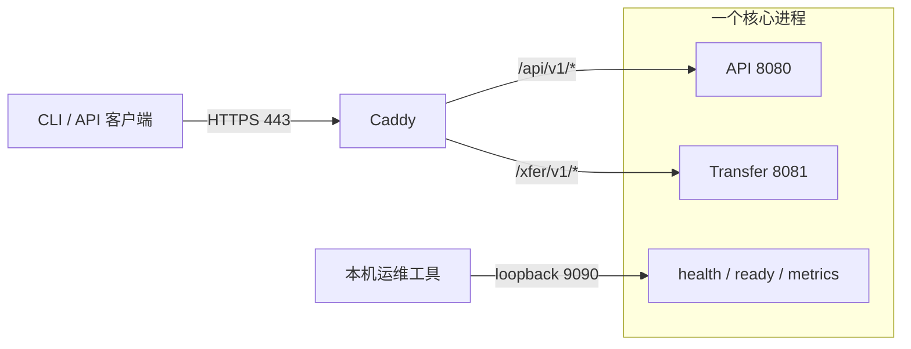

# 单网关部署与本机观测

运行中互斥备份的可选一次性挂载与日常命令见[在线备份](online-backup.md)。使用 `compose.backup.yaml` 时不需要每次修改 Compose 或手工停启 core；该能力属于开发版本，不属于已发布 rc.4。


M1 使用一个 `lantai serve` 核心进程，内部区分 JSON API、文件传输与本机运维监听。对外只有 HTTPS 网关；没有任务执行服务、MCP、网页、长轮询或自动 GC。以下模板供本地和隔离环境审查使用，不包含真实域名、证书、凭据或数据。目标机器的部署与故障恢复仍需单独验收。



## 模板与依赖

| 文件 | 用途 |
|---|---|
| [Caddyfile](../deploy/Caddyfile) | 单 HTTPS 入口、手动证书、API/传输分流、其余路径 404 |
| [config.native.yaml](../deploy/config.native.yaml) | 原生运行，三个监听均绑定数字 loopback |
| [config.container.yaml](../deploy/config.container.yaml) | 容器私网 API/传输监听；运维仍仅容器内 loopback |
| [compose.yaml](../deploy/compose.yaml) | 自动空卷准备、核心与网关；一次 up，仅网关发布端口 |
| [compose.backup.yaml](../deploy/compose.backup.yaml) | 含 backup-online 的版本可选；部署时一次性挂载私有备份根，日常在原 core 触发 |
| [Dockerfile](../deploy/Dockerfile) | Go 1.26.9 编译、无 shell 的非 root 核心镜像 |
| [lantai.service](../deploy/lantai.service) | Linux systemd 核心服务模板，固定单进程、优雅停止 |

网关固定 **Caddy 2.11.4**，Apache-2.0；[官方发布](https://github.com/caddyserver/caddy/releases/tag/v2.11.4)提供二进制、SHA-512 校验和与签名，[许可证](https://github.com/caddyserver/caddy/blob/v2.11.4/LICENSE)随官方包保留。容器模板使用[官方 Caddy 镜像](https://hub.docker.com/_/caddy)，实际部署应再记录所用平台镜像摘要。Go 版本与仓库 `go.mod` 一致，BSD-3-Clause；核心其余依赖见[依赖说明](dependencies.md)。没有新增 Go 运行依赖，也不自动安装网关。

## 数据位置

数据根（含 `db/`）与密钥目录必须在本机文件系统上，满足 POSIX 文件语义与 SQLite WAL 的要求。`init`、`doctor` 与 `serve` 拒绝已识别的网络文件系统；FUSE 默认也拒绝（`fuse_filesystem`），只有在配置中设 `storage.allow_fuse: true` 显式接受风险时才放行，并提示 `filesystem_unverified`。其他无法判断类型的文件系统只提示 `filesystem_unverified`，不阻止启动，这类位置必须先自行验证。

部署前在实际数据位置（`db/` 单独挂载时也包括它）运行 SQLite 探针，并加并发读写实测：

```sh
go run ./scripts/probe/sqlite -dir <数据位置下的目录> -stress 15m > sqlite-report.json
# 目标机没有 Go 时，交叉编译后上传运行，例如 Linux x86_64：
GOOS=linux GOARCH=amd64 CGO_ENABLED=0 go build -o sqlite-probe ./scripts/probe/sqlite
```

报告中 `missing_required` 非空，或 `concurrency_checked` 不为 true，该位置就不能使用。通过只说明这次运行没有发现问题：下面的损坏是间歇性的，对没有把握的位置应在不同时段多次运行；已知出过问题的位置不因一次通过而变为可用。能力项都是低并发检查；不加 `-stress` 发现不了只在多连接并发读写下出现的损坏。并发实测逐行核对内容摘要，结束后用新连接逐库做 `integrity_check`；未通过时测试库保留在报告的 `stress.kept_dir`，复查后自行删除。

NAS 与容器：

- 部分 NAS 系统把共享文件夹经厂商 FUSE 层映射进容器。2026-10 在一台极空间 NAS 的测试容器中实测（映射文件夹为 `zfuse`）：Lantai 的库在并发读写下出现 `SQLITE_CORRUPT` / `SQLITE_NOTADB` 并被持久写坏，有时运行中没有任何报错，只有完整性检查能发现；能力探针的低并发项照样全部通过。问题是间歇性的：同一位置在当天另外几次 10–15 分钟的并发实测中没有出现。这类映射文件夹不能放数据根或密钥目录；数据根放在上面时 Lantai 默认拒绝启动。
- 同一台机器上，落在宿主本地 btrfs 上的 Docker 命名卷通过 15 分钟并发实测，并在其上完成 1 万资产 / 5 万版本的规模运行与空目录恢复。建议数据根与密钥目录各用一个命名卷，对应模板路径 `/var/lib/lantai` 与 `/var/lib/lantai-secrets`；映射的共享文件夹只放备份、导入导出与日志。在同一环境中，停机备份写到映射文件夹、校验后跨机器恢复已实测可用，备份副本的损坏由 `backup-verify` 的校验和发现。
- 命名卷由 Docker 管理：删除卷（包括 `docker compose down -v`）或 Docker 存储损坏都会丢失数据。包含新能力的版本应在部署时按[在线备份](online-backup.md)一次性挂载独立备份目录，日常在原 core 中执行 `backup-online`，完成后用 `backup-verify` 校验并复制到另一台机器；密钥目录另行保管。已发布 rc.4 仍只有停机、持有独占锁的 `backup`，不能把新命令追溯到旧镜像，也不能在活动 core 旁另起离线备份进程。
- 模板 `compose.yaml` 默认将数据与密钥放在两个独立命名卷。旧环境文件若设置 `LANTAI_DATA_DIR` / `LANTAI_SECRETS_DIR`，其原有绝对路径优先用于 prepare 和 core，不会被默认卷覆盖。`prepare` 服务在每次项目启动时检查三个目录，只对空目录根设置 65532:65532 / 0700，绝不递归修改、删除或重新初始化已有数据。已有数据根允许服务所有且不对组/其他用户开放写入的旧权限；密钥与 setup 目录必须 0700。不符时停止，由部署者核对原卷与服务身份。升级必须保留同一 Compose 项目名、原命名卷或原路径，不能换成新的空卷，否则会看到另一个全新实例。

## 本地原生运行

先在仓库外准备独立的本地磁盘数据根和密钥目录。复制原生配置，修改 `instance.name`、`secrets.dir` 和浏览器 `allowed_origins`；不要在配置里放口令或会话。服务账户需要写数据根和密钥目录，网关账户只需要读 TLS 文件。SQLite 不放在网络挂载文件系统。

```sh
go build -o bin/lantai ./cmd/lantai
# LANTAI_HOME 指向仓库外的数据根；先将审核后的 config.yaml 放入该目录。
bin/lantai init --home "$LANTAI_HOME" --admin ada
bin/lantai serve --home "$LANTAI_HOME"
```

初始化交互输入口令、验证器码；恢复码只展示一次。已有实例不重复初始化。服务先取得数据根锁、检查权威状态并恢复/追平，再开放监听；失败不会接受业务流量。停止时先排空 HTTP，再关闭后台写入和数据库。

到期提醒、定时清除与 GC 调度默认关闭。只有在确认保留策略、备份计划与项目 `trash.auto_purge` 后，才在 `config.yaml` 加入 `lifecycle: {scheduler: true}`（可选 `interval_seconds`、`batch`）；也可在服务停止时用 `bin/lantai lifecycle --home "$LANTAI_HOME"` 手动运行一轮。规则见[生命周期调度](contracts/lifecycle-scheduler.md)。外部扩展包需要管理员导入、台账审定与 HumanGrant 启用，一次性宿主不是沙箱，启用时必须明确受信任部署决定，见[扩展包治理](contracts/extension-governance.md)。

另一个终端设置网关环境。以下域名是示例，TLS 文件由部署者在仓库外提供，证书必须覆盖实际域名且客户端信任其签发链。

```sh
export LANTAI_HTTPS_ADDRESS=https://library.example:443
export LANTAI_TLS_CERT=/path/to/tls/cert.pem
export LANTAI_TLS_KEY=/path/to/tls/key.pem
export LANTAI_API_UPSTREAM=127.0.0.1:8080
export LANTAI_TRANSFER_UPSTREAM=127.0.0.1:8081
caddy validate --config deploy/Caddyfile --adapter caddyfile
caddy run --config deploy/Caddyfile --adapter caddyfile
```

模板只监听 HTTPS，不自动开放 HTTP 80、Caddy 管理端口或 HTTP/3 UDP 端口，也不自动申请或续期证书。`LANTAI_GATEWAY_BIND` 默认 `0.0.0.0`；隔离测试设为 `127.0.0.1`，并选非特权随机端口。更换证书后，在本机复核并重启网关；不能靠关闭客户端证书校验解决信任问题。TLS 的手动证书机制见[官方文档](https://caddyserver.com/docs/caddyfile/directives/tls)。

路由不剥离前缀，授权、幂等键、分片摘要和 `Range` 头原样传递。JSON 大小与超时由核心契约限制；文件流使用核心的 I/O 空闲超时与服务端授权档位。网关不配置完整请求/响应缓冲，不重试业务提交，不设置会阻止断连传播的负 `flush_interval`。依据[官方反向代理规则](https://caddyserver.com/docs/caddyfile/directives/reverse_proxy)，模板已实测上传边传边转发、并发 API 与断连取消。

## 容器与系统服务

Compose 的变量来自仓库外的本地环境文件：`LANTAI_IMAGE`、`LANTAI_SETUP_DIR`、`LANTAI_CONFIG_FILE`、`LANTAI_TLS_DIR`、`LANTAI_DOMAIN`；可选 `LANTAI_HTTPS_PORT` 默认为 443。路径使用绝对路径，`LANTAI_TLS_DIR` 含受客户端信任的 `cert.pem` / `key.pem`，配置采用容器模板。`allowed_origins` 必须精确匹配外部 HTTPS 地址，包括非默认端口。

`LANTAI_SETUP_DIR` 是独立的私有宿主目录，不能与数据、密钥或 TLS 目录复用，也不能放入同步/公开共享目录。它挂载到容器 `/var/lib/lantai-setup`；GUI 交付包通常使用项目旁的 `./setup`，不是数据命名卷中的 `db/`。文件界面能否读取其内容取决于 NAS 管理员的实际权限，不保证 GUI 可读。辅助容器需要 CHOWN、FOWNER 和 DAC_READ_SEARCH，只用来准备空目录根及检查现有目录，不访问网络。核心一直以 65532 身份运行且无 capabilities。其 `/tmp` tmpfs 显式使用 `mode=1777`，避免容器引擎重启后默认模式改变，使非 root 核心无法创建本机控制 socket。

```sh
docker build -f deploy/Dockerfile -t lantai:local .
# 在私有环境文件中将 LANTAI_IMAGE 设为 lantai:local，并填写其余占位值。
docker compose --env-file /path/to/local.env -f deploy/compose.yaml config --quiet
docker compose --env-file /path/to/local.env -f deploy/compose.yaml up -d
docker compose --env-file /path/to/local.env -f deploy/compose.yaml stop
```

[Dockerfile 专用忽略文件](../deploy/Dockerfile.dockerignore)仅允许源码和依赖锁文件进入构建上下文，依据 [Docker 官方规则](https://docs.docker.com/build/concepts/context/#filename-and-location)。镜像本身不包含运行数据、主密钥或 TLS 私钥。只有网关同时连接入口 `edge` 桥接网络与内部 `backend`；核心只连接内部网络，且不发布端口。运维采样工具应在核心网络命名空间中访问 loopback，不能把 9090 发布或代理到公网。Scratch 镜像没有 shell/curl，不把宿主 `curl localhost:9090` 误当成容器内检查。

启动后按[首次管理员设置逐步指南](first-setup.md)操作：在有权限的 NAS 文件界面或已有的授权宿主管理工具中读取 `LANTAI_SETUP_DIR/setup-code.json` 的 `code` 字段，打开 `https://<域名>:<端口>/setup/` 填写用户名与口令，再把第二屏的 TOTP 设置密钥手动添加到验证器。页面没有二维码；保存全部恢复码，最后填入验证器当前的 6 位码。文件权限保持 0600、目录 0700；GUI 无权读取时，由管理员提供已有的特权读取方式，不通过日志、公开复制或放宽权限解决。核心镜像没有 shell，不提供容器内 `cat` 读取方法。不同 NAS 的 GUI 能力仍须在目标设备验收。

完成后设置入口永久关闭，核心自动开始正常服务。不需要 profile、交互 run、TTY 或第二次 up。第二步的未确认登记 10 分钟过期；此时刷新 `/setup/`，用原引导码重新填写第一屏，并替换验证器中未完成登记的旧 TOTP 密钥和整组恢复码，不需要重启或删卷。重复开始至少间隔约 10 秒。确认请求丢失时保留密码、TOTP 和恢复码，先检查状态：`/api/v1/meta` 为 200 且 `/setup/` 为 404 表示正常服务已启动；根路径 404 也正常。若提示 `Administrator saved`，身份已提交，按同一实例的激活故障处理，不再建立管理员；仅在相应运维流程要求时重启。引导码仅在初始化期间有效，成功后尽力删除；残留文件不能重新开启设置。

已有 active 实例跳过首次设置，旧 `init` / `serve` 命令继续支持，并沿用正常启动对权威库缺失的拒绝与派生索引重建规则。初始化中的实例只在五库完整、绑定匹配、迁移已应用时续接，不自动补库、迁移、替换密钥或清卷。极早期建库中断造成不完整库集时停止；先用 `doctor` 检查、备份，再由管理员选择原有离线修复流程。升级前备份，始终复用原数据卷与密钥卷；不要执行 `down -v`。

Compose 中 core/gateway 使用 `unless-stopped`，prepare 成功退出。systemd 模板保持原有显式 init/serve 流程，需要先创建服务账户并安装二进制。自动首次设置当前支持 Linux 容器及 macOS 开发验证；Windows 原生保留 CLI 初始化。实现与 HTTP 边界见 [首次设置契约](../api/first-start.md)。CI 的容器测试与目标 NAS 验收分别记录，不能相互替代。

## 本机健康与指标

默认访问 `http://127.0.0.1:9090`，不经网关。运维绑定仅接受数字 loopback，拒绝通配符、网卡地址和可变 DNS 名。没有公共 `/debug/pprof`。

| 路径 | 含义 |
|---|---|
| `GET /healthz` | 进程仍存活返回 200；已关闭返回 503，不代表业务可用 |
| `GET /readyz` | 安全状态与同步均就绪返回 200，否则 503；只返回状态、原因代码，不返回本地路径或原始异常 |
| `GET /metrics` | Prometheus 文本格式；源采样失败仍保留其他源，HTTP 503 且该源 `lantai_collector_available=0`，缺失值不伪报零 |

维护/恢复等实例非 ready 状态拒绝新的 API/传输请求，返回 `MAINTENANCE_MODE`。单纯索引同步滞后使 `/readyz` 为 503，`business_ready` 仍为 true，权威精确读取保持可用。在途命令仍由领域屏障和最终权限复验决定接受。

指标固定低基数，不含主体、项目、操作 ID、对象路径或签名：

| 指标组 | 内容与解释 |
|---|---|
| `live` / `ready` / `business_ready` / `writes_open` | 进程、安全状态、同步与写入屏障 |
| `outbox_pending` / `outbox_oldest_age_seconds` | 按 main / ledger / runtime 的未投递数量及最老事件年龄 |
| `operations_pending` / `operations{stage=...}` | 已知阶段统计；receiving、prepared、installed、blocked、quarantined 属待处置，committed/projected/failed/cancelled 不计 pending |
| `events_*` / `query_*` | 热事件、relay 失败、关键消费者滞后、审计/备份水位、投影代次与重建起点 |
| `transfer_*` / `lock_*` | 当前执行/等待数，累计准入与实际竞争等待次数/时长；累计值随进程重启归零 |
| `uploads_open` / `upload_staging_bytes` / `upload_pins` / `upload_retained_bytes` | storage 权威记录的已接收暂存字节与上传保留事实；不含尚未落记录的在途私有文件或孤儿文件，不是磁盘全盘占用 |
| `upload_sweep_last_success_timestamp_seconds` / `upload_sweep_failures_total` / `uploads_expired_total` | serve 每分钟清扫到期上传会话的最近一次成功时间、失败次数（暂存删除失败等计入，维护期间跳过不计）与累计关闭的会话数；成功时间为成功那一轮的开始时刻，从未成功为 0。时间长期不前进或失败持续增长说明暂存不会回落 |
| `gc_supported` | M1 固定 0，未运行 GC；不输出伪造的 GC 已释放字节 |
| `disk_available_bytes` / `disk_min_free_bytes` | data/database 所在文件系统的普通账户可用空间与配置阈值；两者可能同一文件系统，不能相加 |
| `sqlite_wal_bytes` | 五库当前 WAL 文件大小；没有 WAL 时为零，数据库缺失/非普通文件时采样失败；采样不执行 checkpoint |
| `backups_complete` / `backups_incomplete` / `backup_pins` | operations 持久备份记录与 pin 计数 |
| `backup_last_complete_timestamp_seconds` / `backup_last_verified_timestamp_seconds` | 最近完成/校验时间；从未备份为 0，不能解释为刚刚完成 |

以上名称均加 `lantai_` 前缀。每次采样有两秒数据库读取上下文期限；不同源之间没有跨库事务，因此是观测快照，不可拿来替代恢复/备份一致性证明。根据数据规模设定采样频率；累计时长按秒，字节按逻辑字节记录。

建议关注：`ready=0`、采样源不可用、磁盘低于阈值、outbox 最老年龄持续增长、消费者滞后不收敛、blocked/quarantined 操作存在、WAL 持续增长及备份长期未完成。具体告警阈值需在目标负载下验收，不自动触发写入或清理。

## 日志与验证

核心默认向 stderr 输出白名单 JSONL：时间、内部随机 `observation_id`、监听面、标准方法、响应状态、字节数、耗时及取消状态。未知方法归为 `OTHER`；不记录 URL、query、请求/响应头、正文、原始异常或真实对象 ID。请求编号用于按错误信封中的 `request_id` 定位：服务端生成的记为 `request_id`；客户端自带的即便语法合法也可能是凭据，只记其 SHA-256（`request_id_sha256`，对原值求十六进制摘要即可检索）。错误响应另记错误码 `error_code`，5xx 再记原因类别 `error_cause`（如 `busy`、`io`、`full`、`other`），不记错误文本。日志写入经锁串行化，保持流式传输与 ResponseController 的超时能力。

后台同步（outbox 收录与查询投影、收件箱与审计导出）失败时，同样向 stderr 写白名单 JSONL：`event` 为 `background_sync`，字段有任务 `task`（`outbox_query` / `inbox_audit`）、状态 `status`（`failing` / `recovered`）、失败阶段 `stage`（`relay_main`、`relay_ledger`、`relay_runtime`、`query_catch_up`、`query_rebuild`、`inbox`、`audit_export`）、`error_code`、`error_cause`、连续失败次数与已失败秒数，不记错误文本。首次失败及阶段、错误码或原因变化时立即记录；同一失败持续时每分钟最多一条；恢复时记一条。失败期间 `/readyz` 为 503，原因码 `synchronization_pending`；后台仍每秒重试，从原进度继续。

网关关闭访问日志，运行日志过滤请求、头、URL、原始错误与消息字段，保留级别、时间及结构化定位字段；配置依据[官方日志过滤文档](https://caddyserver.com/docs/caddyfile/directives/log)。本机显式初始化/诊断命令可能显示部署者指定路径或一次性初始化材料，不能把整个终端记录作为公开日志上传。

```sh
go test -race ./internal/application ./internal/commands ./deploy
# 显式指向已核验的官方 2.11.4 二进制；不设置时仅网关执行测试会跳过。
LANTAI_TEST_CADDY=/path/to/caddy go test -race -count=1 -run TestCaddySingleHTTPSGateway -v ./deploy
```

网关测试只绑定随机 loopback 端口，生成临时自签名证书并显式信任，使用合成后端验证实际 Caddyfile：TLS、路由隔离、Range、分片头、上传流、并发 API、断连取消、502 失败日志脱敏。单元测试覆盖未知指标、数据库/WAL 缺失、维护入口拒绝、并发日志与超时透传。真实存取/恢复集成与目标机器性能、容器启动、证书轮换、平台恢复演练应分别记录证据。
